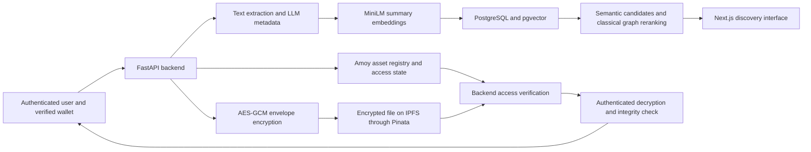

# 20 October 2026 update

Production search now uses deterministic cosine-based maximum marginal relevance (0.85 relevance / 0.15 redundancy), with published-asset filtering and identity deduplication. The earlier graph/QUBO production-path discussion below describes the previous implementation. Ollama scoring now uses the excerpt-v1 evidence rubric. See UI_SEARCH_SCORING_VERIFICATION.md for current methods, checks and limitations. The retained QAOA/VQC experimental results are unchanged.

# DKM research-paper writing pack — payments excluded
Prepared 13 October 2026 from the current workspace and retained experiment outputs.

## 1. Recommended scope and title

**DKM: Blockchain-Backed Knowledge Asset Access and Semantic Retrieval with an Evaluation of Variational Quantum Embeddings**

Alternative, if the QAOA study must also appear:
**A Hybrid Knowledge Asset Platform: Secure Content Access, Semantic Discovery, and Quantum Algorithm Evaluation**

Present a systems prototype plus controlled algorithm evaluation. Exclude payment
providers, checkout, currency conversion, settlement, token funding and fee
distribution. Keep blockchain asset registration, creator identity, license/access
state and integrity verification. The access predicate can be discussed without
describing how its state was acquired.

QAOA pricing is economically themed but distinct from payment processing.
Include it as an optional optimization experiment if the rubric requires QAOA.
For a paper excluding all economic functionality, omit the pricing section and
tell the supervisor that QAOA would need a different, newly evaluated task.
Do not relabel the existing pricing experiment as a retrieval experiment.

## 2. What the contribution can honestly be

Candidate contributions, subject to a fuller related-work comparison:
1. An implemented architecture combining encrypted off-chain files, a blockchain
   asset registry, backend-enforced license checks and searchable metadata.
2. A reproducible discovery pipeline using summary embeddings, metadata graph
   propagation and a classical QUBO selection heuristic.
3. A controlled VQC retrieval evaluation with original embeddings, compressed
   classical embeddings and an untrained-circuit ablation.
4. An explicit separation of NFT ownership, content access and document integrity.

These are system design/integration and evaluation contributions. Do not claim
invention of NFTs, AES, BLAKE3, IPFS, MiniLM, QAOA or VQC. Do not say “first ever”
without a systematic literature review demonstrating that claim.

## 3. Draft abstract

Knowledge-sharing platforms must support document discovery, verifiable asset
registration and controlled access to stored content. This paper presents DKM,
a prototype combining blockchain asset records with encrypted off-chain storage
and semantic retrieval. Uploaded documents are processed into structured metadata;
normalized MiniLM embeddings support vector search, while metadata relationships
provide a supplementary graph-based ranking signal. Content is protected using
AES-GCM envelope encryption, and the backend verifies wallet-linked access rights
before returning decrypted files. The design separates creator-held asset ownership
from non-exclusive user access. We additionally evaluate a four-qubit variational
quantum feature model on a controlled corpus containing 96 documents and 32 queries,
split into 16 validation and 16 test queries. On the test split, original MiniLM
embeddings achieved NDCG@10 of 0.9053, compared with 0.7027 for a four-component
PCA baseline and 0.6093 for the trained quantum model. These results show that the
evaluated quantum representation did not improve retrieval over the classical
baselines. The study provides a reproducible prototype and a bounded empirical
assessment, while identifying centralized key custody, corpus size and retrieval
evaluation as limitations.

Use this as a draft, not a claim that all interactive system acceptance is complete.
State “prototype” and identify actual test/deployment scope in the final manuscript.

Keywords: knowledge assets; semantic retrieval; blockchain access control;
authenticated encryption; variational quantum circuits; reproducible evaluation.

## 4. Paper structure

For approximately 8–10 pages, adjust to the actual venue template:

| Section | Purpose | Suggested space |
|---|---|---|
| Abstract | Problem, approach, actual result and limitation | 150–220 words |
| Introduction | Why discovery, attribution and controlled access must work together | 1 page |
| Related work | Retrieval, encrypted storage, tokenized access, quantum embeddings | 1 page |
| Architecture and threat model | Components, trust boundaries, data placement | 1–1.5 pages |
| Methodology | Ingestion, encryption, retrieval and VQC | 1.5–2 pages |
| Experimental setup | Corpus, splits, baselines, parameters, measures | 1 page |
| Results and discussion | Actual tables, ablations and negative results | 1–1.5 pages |
| Limitations and conclusion | What evidence supports and does not support | 0.5–1 page |

Do not spend pages describing ordinary login buttons, colors or installation
screens. Use UI screenshots only to demonstrate a meaningful workflow or boundary.

Suggested research questions:
- RQ1: How can the prototype combine verifiable asset records with encrypted
  off-chain storage and backend-enforced access?
- RQ2: Does metadata graph propagation/QUBO reranking improve retrieval relative
  to the same semantic candidate pool? **Not yet evaluated by the retained VQC study.**
- RQ3: How does a trainable quantum feature representation compare with original
  and equally compressed classical representations?
- Optional RQ4: How does simulated QAOA compare with classical optimization on
  the specified synthetic bounded-price objective?

## 5. Architecture you can describe

The diagram is conceptual. Wallet signing, database persistence and chain
confirmation are separate operations, not an atomic distributed transaction.

**Data placement**
- Blockchain: asset registration/creator-linked state, references and access state.
- IPFS: ciphertext for assets uploaded through the protected path; published
  metadata may remain public.
- PostgreSQL: accounts, sessions, searchable metadata, normalized vectors, wrapped
  content keys and application linkage.
- Backend configuration: content master key.
- Browser/wallet: authenticated interaction and proof of wallet control.

Call this a **hybrid architecture with decentralized components**. Backend,
database, key custody, pinning and RPC services remain trust/availability dependencies.

## 6. Methods mapped to actual code

| Component | Actual implementation | Suitable paper wording |
|---|---|---|
| Extraction | PDF first five pages, CSV first 51 lines, text capped at 4,000 characters | Bounded document sampling, not exhaustive document understanding |
| Enrichment | LLM title, summary, tags, domain and heuristic quality score | LLM-assisted cataloguing; quality scores are uncalibrated |
| Embeddings | Normalized all-MiniLM-L6-v2, 384 dimensions; upload embeds summary | Summary-based semantic representation |
| Vector retrieval | pgvector cosine distance and metadata filters | Semantic candidate retrieval |
| Graph | Shared tags plus same-domain edge weight | Metadata relationship graph, not a formal ontology |
| Propagation | Three normalized matrix-vector steps | Classical graph propagation heuristic |
| Combined ranking | 0.6 semantic score + 0.4 graph score | Fixed-weight hybrid ranking, weights not proven optimal |
| QUBO selection | Classical simulated annealing, constant pairwise penalty | Binary selection heuristic, not quantum hardware |
| Duplicate guard | Persisted BLAKE3 equality and concurrent insertion guard | Byte-identical duplicate prevention |
| Encryption | Random 256-bit file key, AES-GCM; master-key wrapping | Authenticated envelope encryption |
| Registration | Existing KnowledgeAsset NFT contract | Creator-linked blockchain registration |
| Access | Authenticated wallet plus authoritative contract checks | Backend-enforced license access |
| Reviews | Verified license holders; creators excluded from self-review | Eligibility-restricted reviews, not objective quality certification |

Code locations:
- backend/main.py
- backend/services/text_extractor.py
- backend/services/llm_enrichment.py
- backend/services/embedding.py
- backend/services/pgvector_client.py
- backend/services/quantum_search.py
- backend/services/quantum_hash.py
- backend/services/fraud_detector.py
- backend/services/content_security.py
- backend/services/auth.py
- backend/services/reviews.py
- contracts/contracts/KnowledgeAsset.sol
- backend/research/vqc_embeddings.py and run_embeddings.py

The current llm_enrichment.py contains an existing owner edit. Freeze the exact
evaluated code/configuration before claiming reproducibility from a commit alone.

## 7. Mathematical description

For normalized query/document vectors, similarity is their dot product:
s(q,d) = q^T d.

For graph construction:
w_ij = |tags_i intersection tags_j| + indicator(domain_i = domain_j).

Describe the production propagation exactly as code: row-normalize the adjacency
matrix, multiply a column vector concentrated on the top semantic candidate, then
renormalize its Euclidean norm at each of three steps. The resulting squared
magnitudes supply graph scores. This is not unitary evolution, so it is not a
genuine quantum walk. It is also not automatically a standard stochastic random
walk distribution because of the multiplication direction and renormalization.

Hybrid score:
S_i = 0.6 s_i + 0.4 g_i.

Current binary selection objective:
E(x) = -sum_i S_i x_i + 0.3 sum_(i<j) x_i x_j, where x_i is binary.

Important limitations: the pairwise penalty is constant, not semantic similarity;
there is no exact-k constraint. The implementation fills remaining result slots
after selection. Do not claim it optimizes measured semantic diversity without
a dedicated experiment or a revised formulation.

For retrieval evaluation:
DCG@k = sum_(r=1..k) (2^rel_r - 1) / log2(r+1).
NDCG@k = DCG@k / IDCG@k, with zero returned when IDCG is zero.

## 8. VQC experiment: ready-to-report evidence

Source: research_results/vqc_embeddings.json and VQC_EMBEDDINGS_REPORT.md.

- 96 authored documents; 64 used to fit the representation and decoder.
- 32 total authored queries: **16 validation and 16 test**.
- Training uses document vectors only; no query relevance labels enter fitting.
- Query topics occur in training documents. This is in-domain retrieval.
- Relevance labels are authored topic/domain rules: 3, 1 and 0.
- Pipeline: 384D MiniLM -> training-fitted PCA4 -> arctan-scaled angle encoding ->
  four-qubit circuit -> eight measured features -> ridge expansion to 384D.
- Two layers of RY/RZ gates with ring CNOT entanglement.
- Measurements: four Z and four adjacent ZZ expectations.
- Adam training for 40 epochs; training objective is cosine Gram-matrix alignment.
- Seed 31; local PennyLane default.qubit statevector simulation.
- Expansion to 384D is a learned projection, not recovery of all discarded information.

| Representation | Validation NDCG@10 | Test NDCG@10 |
|---|---:|---:|
| Original MiniLM | 0.915266 | 0.905296 |
| PCA4 + ridge expansion | 0.654188 | 0.702724 |
| Untrained VQC + ridge expansion | 0.534822 | 0.605030 |
| Trained VQC + ridge expansion | 0.611822 | 0.609317 |

Suggested result paragraph:
“The trained VQC obtained test NDCG@10 of 0.6093, below both original MiniLM
(0.9053) and PCA4 with ridge expansion (0.7027). Training improved the circuit
baseline slightly on the test split, from 0.6050 to 0.6093. Without repeated seeds
or uncertainty estimates, this difference should not be interpreted as a robust
generalization gain. The results do not support quantum advantage.”

The retained benchmark encodes authored document text directly. The production
upload pipeline embeds LLM summaries and adds graph/QUBO reranking. Therefore,
these numbers evaluate the representation experiment, NOT end-to-end production
search quality. Do not label the MiniLM score as measured application accuracy.

## 9. Optional QAOA experiment, separate from payment processing

Source: research_results/qaoa_pricing.json and QAOA_PRICING_REPORT.md.

64 independent synthetic cases; each has 100 integer candidate prices represented
with seven qubits. Depth 2, 2,048 samples per case, COBYLA budget of up to 80
objective evaluations. The diagonal cost is negative normalized stipulated
revenue; invalid basis states receive penalty 2. RX mixing alternates with cost
unitaries. Selection uses the modal feasible sampled state.

The stipulated objective is price multiplied by logistic demand and a fixed
positive scaling factor. It is not observed customer demand or earned revenue.
A common positive constant does not change the maximizing price.

| Measure | QAOA simulation | Classical baseline |
|---|---:|---:|
| Exact optimal-price matches | 1/64 | 64/64 |
| Mean relative optimality gap | 17.60% | 0% |
| Mean recorded runtime per case | 0.456721 s | 0.000505 s |

The exhaustive oracle recorded 0.000051 s per case. These are local timings for
different computational approaches, not equal-resource hardware benchmarks.
The full cost diagonal is constructed classically; costs grow exponentially with
qubit count. Report that this small smooth problem favored classical methods.
Do not describe independent cases as a jointly optimized 64-asset portfolio.

## 10. Security analysis and explicit assumptions

Threats you can analyze: unauthenticated access, cross-account requests, replayed
wallet proofs, ciphertext alteration, duplicate uploads and unavailable RPC/storage.

Existing mechanisms include password hashing, session expiry, origin checks,
expiring wallet challenges, authenticated decryption and entitlement verification.
Tests provide bounded evidence; they are not formal proofs or an independent audit.

Limitations to state:
- Backend sees uploaded plaintext and can decrypt stored content. This is not
  end-to-end encryption against the operator.
- Compromise/loss of the master key is a major risk; wrapped keys alone do not
  remove centralized trust.
- Pinning and gateway availability are separate from content integrity.
- Hash equality finds byte-identical files, not paraphrases, plagiarism or truth.
- Blockchain registration does not establish legal authorship or copyright.
- A legitimate reader can redistribute downloaded plaintext; no DRM guarantee.
- Search metadata/summaries and public chain activity may reveal information.
- Legacy public-file assets are not retroactively protected by the encrypted path.
- The “fraud detector” checks duplicates and very small files, not learned fraud.
- LLM quality score is not validated coherence, completeness or originality.
- Google login is not an evaluated feature while credentials remain unconfigured.

## 11. Experiments that would strengthen the paper

These are proposed work, NOT completed measurements. Do not fill results with guesses.

Priority A — evaluate the real search path:
Use a consented/public corpus with independently judged queries. Compare keyword/
BM25, MiniLM summary retrieval, MiniLM plus graph, and full graph/QUBO pipeline.
Use the same candidate pool for reranking comparisons. Include no-edge and sparse
graph cases. Report NDCG@10, Recall@10 and MRR, plus result diversity only if defined.

Priority B — quantify uncertainty:
Evaluate multiple training/optimization seeds and paired per-query differences.
Use paired bootstrap intervals; account for correlated topic/template queries.
A single seed and 16 test queries provide limited evidence. Do not tune on test scores.

Priority C — isolate the bottleneck:
Compare PCA dimensions 4/8/16 and a small classical nonlinear map with comparable
output size/training objective. Keep VQC input/qubit limits explicit and budgets
reported. This requires new experiments and is not supported by existing numbers.

Priority D — system measurements:
Measure extraction/enrichment/embedding/search/encryption/decryption latency,
median and p95, for declared file sizes/concurrency. Separate cold model load from
warm requests. Report environment, errors and throughput. Code comments such as
“~20 ms” are not measured latency evidence.

Priority E — quality and access:
Have independent raters assess summary faithfulness and metadata correctness.
Use a predefined quality rubric and inter-rater agreement. Measure retrieval from
summaries versus source text. Record non-payment access-control cases: valid user,
unentitled user, mismatched wallet, expired proof, tampered ciphertext and RPC outage.

Existing broad automated test counts include payment tests. Do not present those
counts as a dedicated non-payment security evaluation.

## 12. Figures and tables

Recommended figures:
1. Architecture with explicit backend/key-custody trust boundary.
2. Ingestion-to-encrypted-storage sequence and separate authorized retrieval sequence.
3. VQC circuit/pipeline, explicitly labelled classical statevector simulation.
4. NDCG@10 grouped bars using the retained validation/test values.
5. Optional QAOA gap distribution from retained per-case data.

Recommended tables:
- Component and data placement.
- Related work comparison using only features actually documented in each source.
- Corpus/split/model/circuit/hyperparameter settings.
- Baseline results and ablations.
- Threat-to-mitigation mapping with limitations.

Do not include payment dashboards, API credentials, private documents or wallet
secrets in screenshots. Prefer a public harmless sample asset.

## 13. References to start from

Use primary sources, cite at the relevant method, and export publisher/arXiv
BibTeX before submission. This is a starter set, not a completed related-work review.

1. Reimers and Gurevych, Sentence-BERT: Sentence Embeddings using Siamese
   BERT-Networks (2019): https://arxiv.org/abs/1908.10084
2. MiniLM model card for the actual embedding checkpoint:
   https://huggingface.co/sentence-transformers/all-MiniLM-L6-v2
3. Lloyd et al., Quantum embeddings for machine learning (2020):
   https://arxiv.org/abs/2001.03622
4. Farhi, Goldstone and Gutmann, A Quantum Approximate Optimization Algorithm
   (2014): https://arxiv.org/abs/1411.4028
5. Benet, IPFS — Content Addressed, Versioned, P2P File System (2014):
   https://arxiv.org/abs/1407.3561
6. NIST SP 800-38D, Galois/Counter Mode and GMAC:
   https://csrc.nist.gov/pubs/sp/800/38/d/final
7. ERC-721 specification: https://eips.ethereum.org/EIPS/eip-721
8. Official BLAKE3 implementation and documentation:
   https://github.com/BLAKE3-team/BLAKE3

Cite external papers for methods and your own repository/results for your
implementation and measurements. External citations cannot validate DKM results.

## 14. Reproducibility and submission checklist

- Freeze exact code commit AND any relevant uncommitted modifications.
- Record Python, PennyLane, NumPy, scikit-learn, sentence-transformers and model
  checkpoint versions; retained result JSON includes experiment package versions.
- Include seeds, corpus, authored relevance rules, document/query splits, training
  trace, decoder/model artifact and scripts.
- Report processor/RAM/OS separately if making runtime claims; do not infer them
  from a dependency version.
- Explain the production-summary/benchmark-text distinction.
- Clearly separate implemented, locally tested, deployed and proposed behavior.
- State negative results and absence of hardware quantum execution.
- Replace broad “fully decentralized”, “quantum secure”, “fraud-proof” and
  “guaranteed originality” claims with the precise mechanisms above.
- Obtain supervisor approval for target venue/template, author order and scope.
- Follow venue rules for AI-assisted writing disclosure; authors verify all claims
  and citations and remain responsible for the submission.
- Research results were inspected, not rerun, while preparing this pack.

## 15. What to provide next

The required college/journal template, page limit, citation style, author details,
submission deadline and whether QAOA pricing must remain despite excluding
payments. These determine the final manuscript layout. No credentials or private
project data are needed.

A stronger paper comes from a clear research question, fair comparisons,
reproducible evidence and honest limitations—not a larger list of features.

